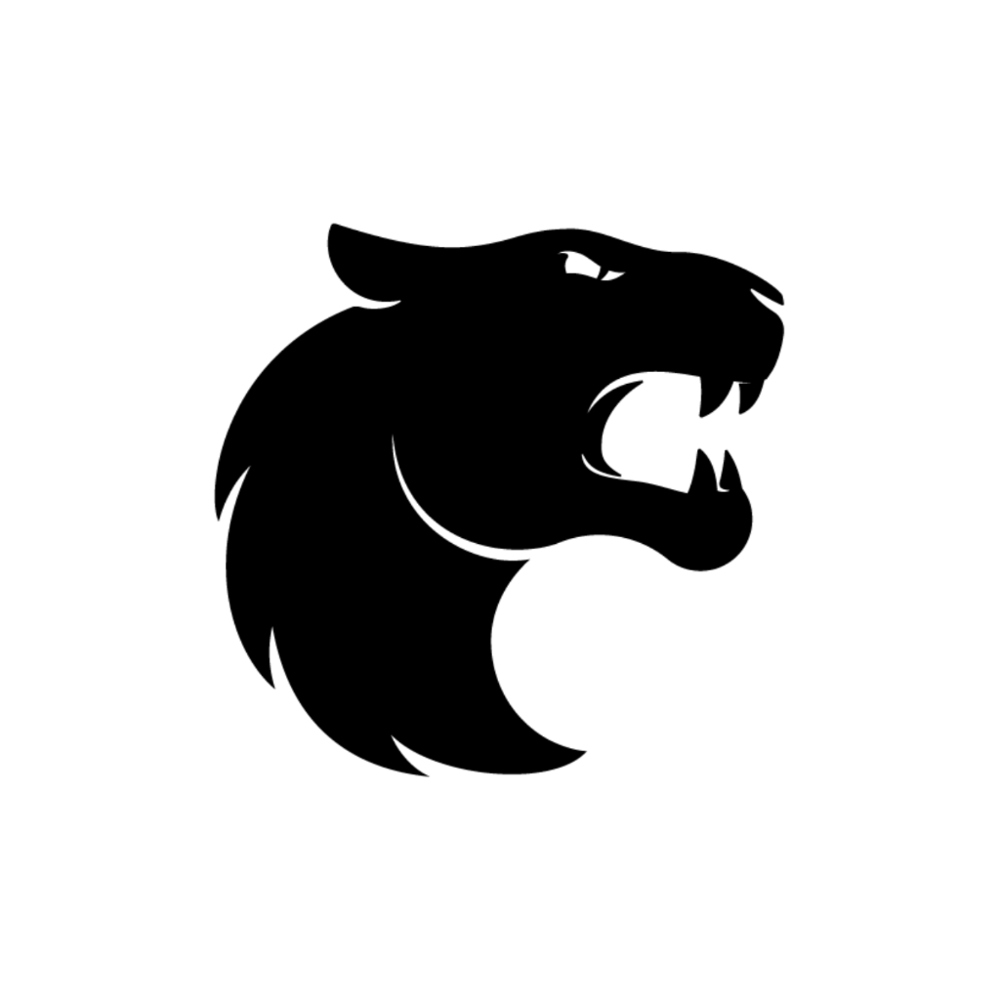

# 🔥 FURIA CS2 FANBOT - Landing Page

<div align="center">
  
  <h3>🤖 Telegram Bot para Fãs da FURIA Esports 🤖</h3>
  <p><i>Landing page promocional para o bot de Telegram dedicado aos fãs da FURIA CS2</i></p>
  <p><b>Site moderno e responsivo para divulgação do fanbot</b></p>


</div>

## 📋 Descrição

Landing page moderna e responsiva desenvolvida para divulgar o bot de Telegram FURIA CS2 FANBOT. O site apresenta todos os recursos do bot, formas de interação e convida os visitantes a iniciarem uma conversa diretamente no Telegram.

## 🚀 Tecnologias Utilizadas

| Tecnologia               | Descrição                                           |
| ------------------------ | --------------------------------------------------- |
| ⚡ **Next.js**           | Framework React para renderização otimizada         |
| 🎨 **Tailwind CSS**      | Framework CSS para design responsivo e moderno      |
| 📱 **Mobile First**      | Abordagem de design priorizando dispositivos móveis |
| 📐 **Design Responsivo** | Layout adaptável para todos os tamanhos de tela     |
| 🖋️ **TypeScript**        | Desenvolvimento com tipagem segura                  |
| 🧩 **Componentes React** | Arquitetura baseada em componentes reutilizáveis    |
| 🌐 **SEO Otimizado**     | Meta tags e estrutura otimizada para buscadores     |

## 🚀 Deploy

O site está atualmente hospedado na Vercel e pode ser acessado em: [https://furia-fanbot.vercel.app/](https://furia-fanbot.vercel.app/)

## 📚 Instalação e Execução

### Pré-requisitos

- [Node.js](https://nodejs.org/) (v20 ou superior)
- npm ou yarn

```bash
# Clone o repositório
git clone https://github.com/seu-usuario/furia-fanbot.git

# Navegue até a pasta da landing page
cd furia-fanbot/landing-page/

# Instale as dependências
npm install
# OU
yarn install

# Inicie o servidor de desenvolvimento
npm run dev
# OU
yarn dev
```

✅ O site estará disponível em: `http://localhost:3000`

## 🖥️ Estrutura de Componentes

| Componente      | Descrição                                     |
| --------------- | --------------------------------------------- |
| 🏠 **Hero**     | Seção principal com chamada para ação         |
| 🛠️ **Features** | Lista de recursos disponíveis no bot          |
| 👣 **Footer**   | Rodapé com links sociais e informações legais |

## 📱 Design Responsivo

- ✅ Layout adaptável para todos os dispositivos
- ✅ Experiência fluida em desktops, tablets e smartphones
- ✅ Menu de navegação otimizado para dispositivos móveis

## 📸 Screenshots

<div align="center">
  <h3>🖥️ Desktop</h3>
  
  <p><i>Seção Hero - Desktop</i></p>
  
  <p><i>Seção Features - Desktop</i></p>
  
  <p><i>Seção Footer - Desktop</i></p>

  <h3>📱 Mobile</h3>
  <div style="display: flex; justify-content: center; gap: 20px;">
    <div>
      <div>
        
        <p><i>Seção Hero - Mobile</i></p>
      </div>
      <div>
        
        <p><i>Seção Features - Mobile</i></p>
      </div>
      <div>
        
        <p><i>Seção Footer - Mobile</i></p>  
      </div>
    </div>
  </div>
</div>

## 🎨 Paleta de Cores

| Cor             | Hex       | Uso                |
| --------------- | --------- | ------------------ |
| ⚪ **Branco**   | `#FFFFFF` | Texto e contrastes |
| ⚫ **Preto**    | `#000000` | Fundos e base      |
| 🔴 **Vermelho** | `#EF4444` | Detalhes e acentos |
| 🔵 **Azul**     | `#3B82F6` | Detalhes e acentos |

## 🌟 Recursos Destacados

- ⚡ Site com carregamento rápido e otimizado
- 🎯 Chamadas para ação claras e diretas
- 📊 Exibição visual dos recursos do bot
- 🔗 Integração direta com o link do bot no Telegram
- 📱 Experiência perfeita em todos os dispositivos

## 🏆 Integração com Redes Sociais

- Telegram: [@furiacs2_pedrosmaxy_bot](https://t.me/furiacs2_pedrosmaxy_bot)
- Twitter/X: [@FURIA](https://x.com/FURIA)
- Facebook: [furiagg](https://www.facebook.com/furiagg)
- TikTok: [@furiagg](https://www.tiktok.com/@furiagg)
- Twitch: [furiatv](https://www.twitch.tv/furiatv)
- YouTube: [@FURIAgg](https://www.youtube.com/@FURIAgg)

## 🚀 Deploy

Para fazer deploy da landing page, recomendamos:

```bash
# Build do projeto
npm run build
# OU
yarn build

# Iniciar em modo de produção
npm start
# OU
yarn start
```

## 🐳 Docker

Para facilitar a implantação e garantir consistência entre ambientes, o projeto pode ser executado via Docker:

### Pré-requisitos

- Docker instalado em sua máquina

### Instruções

```bash
# Construir a imagem Docker
docker build -t furia-landing-page .

# Executar o container
docker run -p 3000:3000 furia-landing-page
```

## 👨‍💻 Desenvolvedor

**Pedro Henrique Novais**
_Projeto desenvolvido para o desafio Experiência Conversacional FURIA_

## 🏆 Status do Projeto

- ✅ Design responsivo completo
- ✅ Otimizado para SEO
- ✅ Pronto para produção
- ✅ Integração com bot de Telegram

---

<div align="center">
  <h3>🔥 FURIA CS2 FANBOT - Landing Page 🔥</h3>
  <p><i>Este projeto foi desenvolvido para fins acadêmicos e demonstração de habilidades técnicas em desenvolvimento front-end moderno com Next.js e TailwindCSS.</i></p>
</div>
